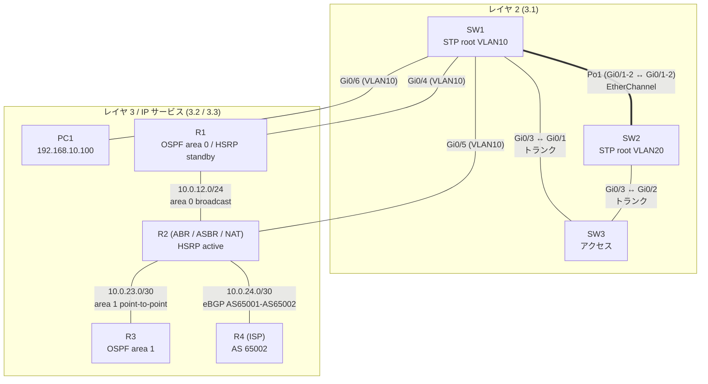

# 0. ラボ準備 (開始前に実施)

!!! tip "所要時間"
    本編開始前に済ませておきます (本編の 30 分には含みません)。
    初期コンフィグを貼り付けるだけで完了します。

## トポロジー

3 台のスイッチ (SW1〜SW3) で L2 を、4 台のルーター (R1〜R4) で L3 / IP サービスを学びます。
すべてのトピックで**同じトポロジー**を使い回します。



### アドレス設計

| デバイス | インターフェイス | アドレス | 接続先 / 用途 |
|----------|------------------|----------|---------------|
| R1 | Lo0 | 1.1.1.1/32 | Router ID / NTP サーバー |
| R1 | Gi0/0 | 10.0.12.1/24 | R2 Gi0/0 (OSPF area 0) |
| R1 | Gi0/1 | 192.168.10.1/24 | SW1 Gi0/4 (VLAN 10) |
| R2 | Lo0 | 2.2.2.2/32 | Router ID |
| R2 | Gi0/0 | 10.0.12.2/24 | R1 Gi0/0 |
| R2 | Gi0/1 | 192.168.10.2/24 | SW1 Gi0/5 (VLAN 10) |
| R2 | Gi0/2 | 10.0.23.1/30 | R3 Gi0/0 (OSPF area 1) |
| R2 | Gi0/3 | 10.0.24.1/30 | R4 Gi0/0 (eBGP / NAT outside) |
| R3 | Lo0 | 3.3.3.3/32 | Router ID |
| R3 | Lo10 / Lo11 / Lo12 | 10.3.0.1/24 / 10.3.1.1/24 / 10.3.2.1/24 | 要約・フィルタ用の模擬ネットワーク |
| R3 | Gi0/0 | 10.0.23.2/30 | R2 Gi0/2 |
| R4 | Lo0 | 4.4.4.4/32 | Router ID |
| R4 | Lo100 | 203.0.113.1/24 | インターネット上の宛先 (模擬) |
| R4 | Gi0/0 | 10.0.24.2/30 | R2 Gi0/3 |
| PC1 | Gi0/0 | 192.168.10.100/24 | GW: 192.168.10.254 (HSRP VIP) |

| 項目 | 値 |
|------|----|
| VLAN | 10 (USERS) / 20 (SERVERS) / 99 (NATIVE) |
| BGP AS | R2: 65001 / R4: 65002 |
| HSRP/VRRP VIP | 192.168.10.254 (グループ 10) |
| 公開アドレス (模擬) | 198.51.100.0/24 (R2 が BGP で広告 / NAT 用) |

!!! note "インターフェイス名について"
    Gi0/x は CML の IOSv / IOSvL2 を想定した表記です。実機や Cat9000v などでは
    `GigabitEthernet1/0/x` などに読み替えてください。

## 初期コンフィグ

各デバイスのコンソールで `configure terminal` に入り、貼り付けます。
(ここにはトピックの設定を**含んでいません**。トランク、EtherChannel、STP、ルーティングなどは本編で設定します。)

=== "SW1"

    ```text
    hostname SW1
    no ip domain-lookup
    vlan 10
     name USERS
    vlan 20
     name SERVERS
    vlan 99
     name NATIVE
    interface GigabitEthernet0/4
     description to-R1
     switchport mode access
     switchport access vlan 10
    interface GigabitEthernet0/5
     description to-R2
     switchport mode access
     switchport access vlan 10
    interface GigabitEthernet0/6
     description to-PC1
     switchport mode access
     switchport access vlan 10
    ```

=== "SW2"

    ```text
    hostname SW2
    no ip domain-lookup
    vlan 10
     name USERS
    vlan 20
     name SERVERS
    vlan 99
     name NATIVE
    ```

=== "SW3"

    ```text
    hostname SW3
    no ip domain-lookup
    vlan 10
     name USERS
    vlan 20
     name SERVERS
    vlan 99
     name NATIVE
    ```

=== "R1"

    ```text
    hostname R1
    no ip domain-lookup
    interface Loopback0
     ip address 1.1.1.1 255.255.255.255
    interface GigabitEthernet0/0
     description to-R2
     ip address 10.0.12.1 255.255.255.0
     no shutdown
    interface GigabitEthernet0/1
     description to-SW1-VLAN10
     ip address 192.168.10.1 255.255.255.0
     no shutdown
    ```

=== "R2"

    ```text
    hostname R2
    no ip domain-lookup
    interface Loopback0
     ip address 2.2.2.2 255.255.255.255
    interface GigabitEthernet0/0
     description to-R1
     ip address 10.0.12.2 255.255.255.0
     no shutdown
    interface GigabitEthernet0/1
     description to-SW1-VLAN10
     ip address 192.168.10.2 255.255.255.0
     no shutdown
    interface GigabitEthernet0/2
     description to-R3
     ip address 10.0.23.1 255.255.255.252
     no shutdown
    interface GigabitEthernet0/3
     description to-R4
     ip address 10.0.24.1 255.255.255.252
     no shutdown
    ```

=== "R3"

    ```text
    hostname R3
    no ip domain-lookup
    interface Loopback0
     ip address 3.3.3.3 255.255.255.255
    interface Loopback10
     ip address 10.3.0.1 255.255.255.0
    interface Loopback11
     ip address 10.3.1.1 255.255.255.0
    interface Loopback12
     ip address 10.3.2.1 255.255.255.0
    interface GigabitEthernet0/0
     description to-R2
     ip address 10.0.23.2 255.255.255.252
     no shutdown
    ```

=== "R4"

    ```text
    hostname R4
    no ip domain-lookup
    interface Loopback0
     ip address 4.4.4.4 255.255.255.255
    interface Loopback100
     ip address 203.0.113.1 255.255.255.0
    interface GigabitEthernet0/0
     description to-R2
     ip address 10.0.24.2 255.255.255.252
     no shutdown
    ```

=== "PC1 (ルーターで代用)"

    ```text
    hostname PC1
    no ip routing
    no ip domain-lookup
    interface GigabitEthernet0/0
     ip address 192.168.10.100 255.255.255.0
     no shutdown
    ip default-gateway 192.168.10.254
    ```

## 開始前チェック (1 分)

```text
R1# ping 10.0.12.2
R2# ping 10.0.23.2
R2# ping 10.0.24.2
R1# ping 192.168.10.2
```

すべて成功すれば準備完了です。

!!! info "進行のコツ"
    - `show` 系コマンドは `do show ...` で設定モードからも実行できます。
    - 時間が足りなくなったら、**各トピックの「壊して直す」を省略**して次へ進んでください。
    - 3.3.a の NTP は同期に数分かかるため、**先に設定して最後に確認**します。
