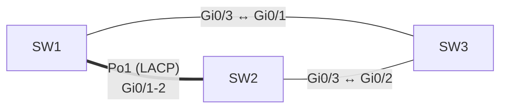

# 3.1 レイヤ 2

使用デバイス: **SW1 / SW2 / SW3**



---

## 3.1.a 802.1Q 静的および動的トランキングのトラブルシュート { #31a-8021q }

!!! abstract "所要 2 分 / 目標"
    DTP による動的トランク形成と静的トランクの違いを理解し、
    `show interfaces trunk` でトランクの不具合を切り分けられる。

### 概念

- **802.1Q**: イーサネットフレームに 4 バイトのタグ (VLAN ID 12 ビット) を挿入。**ネイティブ VLAN** はタグなしで送信される。
- **DTP (Dynamic Trunking Protocol)**: Cisco 独自。トランクを自動ネゴシエーションする。

**DTP モードの組み合わせ結果**

| 自 \ 相手 | dynamic auto | dynamic desirable | trunk | access |
|-----------|:---:|:---:|:---:|:---:|
| **dynamic auto** | access | **trunk** | **trunk** | access |
| **dynamic desirable** | **trunk** | **trunk** | **trunk** | access |
| **trunk** | **trunk** | **trunk** | **trunk** | 不整合 (接続不可) |
| **access** | access | access | 不整合 (接続不可) | access |

!!! tip "試験ポイント"
    - `auto` × `auto` は **トランクにならない** (どちらも待つだけ)。
    - 推奨は **静的トランク (`mode trunk`) + `switchport nonegotiate`**。DTP を使わない。
    - `switchport nonegotiate` を片側だけ設定すると、動的側は DTP フレームを受け取れずトランクにならない。

### ハンズオン

**手順 1: 動的トランク (DTP)** — SW1 ↔ SW3

=== "SW1"

    ```text
    interface GigabitEthernet0/3
     switchport trunk encapsulation dot1q
     switchport mode dynamic desirable
    ```

=== "SW3"

    ```text
    interface GigabitEthernet0/1
     switchport trunk encapsulation dot1q
     switchport mode dynamic auto
    ```

!!! note
    `switchport trunk encapsulation dot1q` は ISL をサポートするプラットフォームでのみ必要です
    (Catalyst 9000 など 802.1Q のみのプラットフォームではエラーになるため省略)。

**手順 2: 静的トランクへ変更** (SW1 ↔ SW3、SW2 ↔ SW3)

=== "SW1"

    ```text
    interface GigabitEthernet0/3
     switchport mode trunk
     switchport nonegotiate
     switchport trunk native vlan 99
     switchport trunk allowed vlan 10,20,99
    ```

=== "SW2"

    ```text
    interface GigabitEthernet0/3
     switchport trunk encapsulation dot1q
     switchport mode trunk
     switchport nonegotiate
     switchport trunk native vlan 99
     switchport trunk allowed vlan 10,20,99
    ```

=== "SW3"

    ```text
    interface range GigabitEthernet0/1 - 2
     switchport trunk encapsulation dot1q
     switchport mode trunk
     switchport nonegotiate
     switchport trunk native vlan 99
     switchport trunk allowed vlan 10,20,99
    ```

### 確認

```text
SW1# show interfaces trunk
SW1# show interfaces gigabitEthernet 0/3 switchport
SW1# show dtp interface gigabitEthernet 0/3
```

`show interfaces trunk` は 4 つのブロックで読みます。

| ブロック | 見るポイント |
|----------|--------------|
| Port / Mode / Encapsulation / Status / Native vlan | `Status: trunking`、ネイティブ VLAN が**両端で一致** |
| Vlans allowed on trunk | 許可 VLAN リストに必要な VLAN が含まれているか |
| Vlans allowed and active in management domain | VLAN が**そのスイッチに存在**するか |
| Vlans in spanning tree forwarding state and not pruned | STP でブロックされていないか |

### 壊して直す (トラブルシュート演習)

SW3 の Gi0/1 のネイティブ VLAN を変更して、エラーを観察します。

```text
SW3(config)# interface GigabitEthernet0/1
SW3(config-if)# switchport trunk native vlan 1
```

- 期待されるログ: `%CDP-4-NATIVE_VLAN_MISMATCH` / `%SPANTREE-2-RECV_PVID_ERR`
- 復旧: `switchport trunk native vlan 99` に戻す。

**トランク不具合のチェックリスト**

1. 両端のモードの組み合わせは適切か (表を参照)
2. ネイティブ VLAN は一致しているか
3. 許可 VLAN リスト (`allowed vlan`) は両端で整合しているか
4. VLAN がスイッチに作成されているか (`show vlan brief`)
5. `nonegotiate` が片側だけになっていないか
6. カプセル化方式 (dot1q) は一致しているか
7. ポートが `err-disabled` になっていないか

---

## 3.1.b 静的および動的 EtherChannel のトラブルシュート { #31b-etherchannel }

!!! abstract "所要 3 分 / 目標"
    LACP / PAgP / 静的 (on) の違いを理解し、バンドルが形成されない原因を
    `show etherchannel summary` から特定できる。

### 概念

| 方式 | 規格 | モード | 形成条件 |
|------|------|--------|----------|
| **LACP** | IEEE 802.3ad / 802.1AX | `active` / `passive` | active-active、active-passive |
| **PAgP** | Cisco 独自 | `desirable` / `auto` | desirable-desirable、desirable-auto |
| **静的** | — | `on` | **on-on のみ** (ネゴシエーションなし) |

- `passive` × `passive`、`auto` × `auto` は**形成されない**。
- プロトコルの異なるモード同士 (例: `active` と `desirable`) は**形成されない**。
- `on` と `active` の組み合わせも**形成されない**。
- メンバーポートは **速度、デュプレックス、VLAN、トランクモード、ネイティブ VLAN、許可 VLAN** が一致している必要がある。
- ロードバランスは**フローごと** (送信元/宛先の MAC・IP・L4 ポートのハッシュ)。

### ハンズオン

**手順: LACP (動的) の EtherChannel** — SW1 ↔ SW2

!!! tip
    メンバーポートを `shutdown` してから設定し、最後に `no shutdown` すると、
    設定途中の不整合による `err-disabled` を避けられます。

=== "SW1"

    ```text
    interface range GigabitEthernet0/1 - 2
     shutdown
     switchport trunk encapsulation dot1q
     switchport mode trunk
     switchport nonegotiate
     switchport trunk native vlan 99
     switchport trunk allowed vlan 10,20,99
     channel-group 1 mode active
     no shutdown
    port-channel load-balance src-dst-ip
    ```

=== "SW2"

    ```text
    interface range GigabitEthernet0/1 - 2
     shutdown
     switchport trunk encapsulation dot1q
     switchport mode trunk
     switchport nonegotiate
     switchport trunk native vlan 99
     switchport trunk allowed vlan 10,20,99
     channel-group 1 mode active
     no shutdown
    port-channel load-balance src-dst-ip
    ```

!!! note
    `switchport nonegotiate` を併用しても LACP は影響を受けません (DTP のみ無効化)。
    ポートチャネル (Po1) インターフェイスにはメンバーの設定が自動で反映されます。

### 確認

```text
SW1# show etherchannel summary
SW1# show lacp neighbor
SW1# show etherchannel load-balance
SW1# show interfaces trunk
```

`show etherchannel summary` の出力例:

```text
Group  Port-channel  Protocol    Ports
------+-------------+-----------+-----------------------------------------------
1      Po1(SU)         LACP      Gi0/1(P)    Gi0/2(P)
```

| フラグ | 意味 |
|--------|------|
| `S` / `U` | Po が L2 / 使用中 (正常) |
| `D` | Po がダウン |
| `P` | ポートがバンドルされている (正常) |
| `I` | スタンドアロン (バンドルされていない) |
| `s` | サスペンド (設定不一致など) |
| `w` | 待機中 |

### 壊して直す

SW2 側のモードを `on` に変更し、バンドルが壊れることを確認します。

```text
SW2(config)# interface range GigabitEthernet0/1 - 2
SW2(config-if-range)# channel-group 1 mode on
```

- `show etherchannel summary` でフラグ (`I` / `s` / `D`) と `show lacp neighbor` を確認。
- 復旧: `channel-group 1 mode active` に戻す。

**EtherChannel 不具合のチェックリスト**

1. 両端のモードは互換か (LACP / PAgP / on を混在させていないか)
2. メンバーポートの速度・デュプレックス・トランク設定は同一か
3. 許可 VLAN・ネイティブ VLAN は同一か
4. `show etherchannel detail` / `show interfaces status err-disabled` で原因を確認
5. STP EtherChannel Guard が作動していないか (`%SPANTREE-2-CHNL_MISCFG`)
6. バンドル上限 (LACP は最大 16 ポート、うちアクティブは 8) を超えていないか

---

## 3.1.c 一般的なスパニングツリープロトコル (RSTP、MST) と拡張機能の設定と確認 { #31c-stp-rstp-mst }

!!! abstract "所要 4 分 / 目標"
    Rapid PVST+ と MST を設定し、ルートブリッジの制御と、
    PortFast / BPDU Guard / Root Guard / Loop Guard の役割を説明・確認できる。

### 概念

| 方式 | 規格 | 特徴 |
|------|------|------|
| **Rapid PVST+** | 802.1w (VLAN ごと) | VLAN ごとに STP インスタンス。高速収束。多 VLAN で CPU 負荷が大きい |
| **MST** | 802.1s | 複数 VLAN を**インスタンス**にマップ。リージョン (名前・リビジョン・VLAN マップ) が一致必須 |

**RSTP のポートロールと状態**

| ポートロール | 説明 |
|--------------|------|
| Root | ルートブリッジへの最良パス |
| Designated | セグメントのルートへの最良パス |
| Alternate | ルートポートのバックアップ (別スイッチ経由) |
| Backup | 指定ポートのバックアップ (同一スイッチ) |

状態は `Discarding` / `Learning` / `Forwarding` の 3 つ。proposal/agreement により高速に遷移する。

**拡張機能**

| 機能 | 設定 | 目的 |
|------|------|------|
| **PortFast** | `spanning-tree portfast` | エッジポートを即 Forwarding に遷移 |
| **BPDU Guard** | `spanning-tree bpduguard enable` | PortFast ポートが BPDU を受信したら `err-disabled` |
| **BPDU Filter** | `spanning-tree bpdufilter enable` | BPDU の送受信を抑止 (**ループの危険あり**) |
| **Root Guard** | `spanning-tree guard root` | 上位 BPDU を受信したら `root-inconsistent` (ブロック) |
| **Loop Guard** | `spanning-tree guard loop` | BPDU 途絶による Alternate/Root ポートの誤 Forwarding を防止 |
| **UDLD** | `udld enable` / `udld port aggressive` | 単方向リンクを検出 |

!!! tip "試験ポイント"
    - **Root Guard**: ルートになってはいけないスイッチ向けの指定ポート (ディストリビューション → アクセス方向)。
    - **Loop Guard**: 非指定ポート (アップリンク側) に設定。Root Guard とは**同一ポートで併用不可**。
    - **BPDU Guard**: エッジポート。復旧は `shutdown` → `no shutdown` か `errdisable recovery cause bpduguard`。

### ハンズオン

**手順 1: Rapid PVST+ とルートブリッジ制御**

=== "SW1"

    ```text
    spanning-tree mode rapid-pvst
    spanning-tree vlan 10 root primary
    spanning-tree vlan 20 root secondary
    !
    interface range GigabitEthernet0/4 - 6
     spanning-tree portfast
     spanning-tree bpduguard enable
    !
    interface GigabitEthernet0/3
     spanning-tree guard root
    ```

=== "SW2"

    ```text
    spanning-tree mode rapid-pvst
    spanning-tree vlan 20 root primary
    spanning-tree vlan 10 root secondary
    !
    interface GigabitEthernet0/3
     spanning-tree guard root
    ```

=== "SW3"

    ```text
    spanning-tree mode rapid-pvst
    !
    interface range GigabitEthernet0/1 - 2
     spanning-tree guard loop
    ```

!!! note
    SW1 の Gi0/4〜6 はルーター/PC 接続のエッジポートです。
    SW1 と SW2 間は Po1 のため、Root Guard は SW3 向けポートに設定しています。

**確認 (Rapid PVST+)**

```text
SW1# show spanning-tree vlan 10
SW1# show spanning-tree summary
SW3# show spanning-tree vlan 10 | include Root|Altn|Desg
SW1# show spanning-tree inconsistentports
SW1# show spanning-tree interface GigabitEthernet0/3 detail
```

期待結果: VLAN 10 のルートは SW1、VLAN 20 のルートは SW2。SW3 は片方の上り経路が `Altn BLK`。

**手順 2: MST へ移行** (全スイッチで実施)

=== "SW1"

    ```text
    spanning-tree mode mst
    spanning-tree mst configuration
     name CCNP
     revision 1
     instance 1 vlan 10
     instance 2 vlan 20
    exit
    spanning-tree mst 1 priority 4096
    spanning-tree mst 2 priority 8192
    ```

=== "SW2"

    ```text
    spanning-tree mode mst
    spanning-tree mst configuration
     name CCNP
     revision 1
     instance 1 vlan 10
     instance 2 vlan 20
    exit
    spanning-tree mst 1 priority 8192
    spanning-tree mst 2 priority 4096
    ```

=== "SW3"

    ```text
    spanning-tree mode mst
    spanning-tree mst configuration
     name CCNP
     revision 1
     instance 1 vlan 10
     instance 2 vlan 20
    exit
    ```

!!! warning
    STP モード変更は一時的な通信断を伴います。本番では**メンテナンスウィンドウ**で実施します。

**確認 (MST)**

```text
SW1# show spanning-tree mst configuration
SW1# show spanning-tree mst 1
SW3# show spanning-tree mst
SW1# show spanning-tree summary
```

### 壊して直す

いずれか 1〜2 つを選んで実施します (MST 構成の状態で実施)。

1. **Root Guard**: SW3 を上位ブリッジにして、SW1 の Root Guard を作動させます。
   ```text
   SW3(config)# spanning-tree mst 1 priority 0
   SW1# show spanning-tree inconsistentports
   ```
    - 期待されるログ: `%SPANTREE-2-ROOTGUARD_BLOCK` (SW1 Gi0/3 が `Root Inc` になる)
    - 復旧: `SW3(config)# no spanning-tree mst 1 priority` (BPDU が止まると自動復旧)
2. **BPDU Guard**: BPDU が流れているトランクポートに BPDU Guard を設定し、`err-disabled` を再現します。
   ```text
   SW1(config)# interface GigabitEthernet0/3
   SW1(config-if)# spanning-tree portfast trunk
   SW1(config-if)# spanning-tree bpduguard enable
   SW1# show interfaces status err-disabled
   ```
    - 期待されるログ: `%SPANTREE-2-BLOCK_BPDUGUARD` (Gi0/3 が `err-disabled`)
    - 復旧: 設定を戻してから `shutdown` → `no shutdown`
      ```text
      SW1(config-if)# no spanning-tree portfast trunk
      SW1(config-if)# no spanning-tree bpduguard enable
      SW1(config-if)# shutdown
      SW1(config-if)# no shutdown
      ```
3. **MST リージョン不一致**: SW3 の `revision` を 2 に変更し、
   `show spanning-tree mst configuration` で SW3 が別リージョンになる (ダイジェスト不一致) ことを確認します。
   復旧は `revision 1` に戻します。

**STP トラブルシュートのチェックリスト**

1. ルートブリッジは意図したスイッチか (`show spanning-tree root`)
2. MST: 名前・リビジョン・VLAN マップが全スイッチで一致しているか
3. `*_Inc` (inconsistent) 状態のポートはないか (Root / Loop / Type / PVID)
4. エッジポートに PortFast + BPDU Guard を設定したか
5. 不要なトポロジー変更 (TCN) が頻発していないか (`show spanning-tree detail | include occur|from`)
