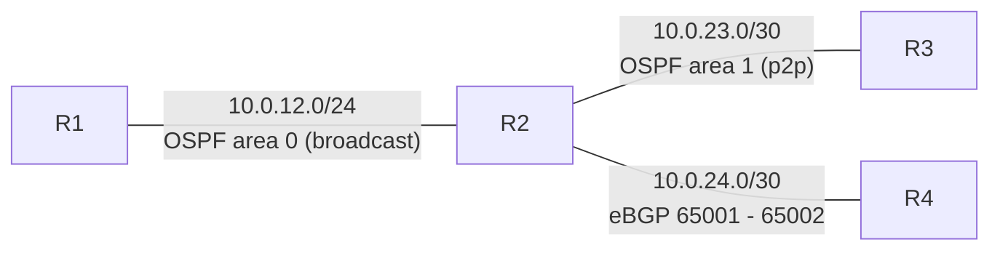
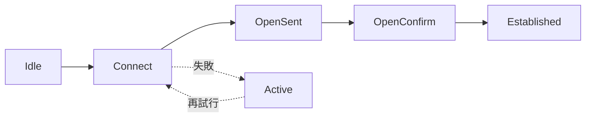

# 3.2 レイヤ 3

使用デバイス: **R1 / R2 / R3 / R4**



---

## 3.2.a EIGRP と OSPF のルーティング概念の比較 { #32a-eigrp-ospf }

!!! abstract "所要 2 分 / 目標"
    EIGRP (拡張ディスタンスベクター型) と OSPF (リンクステート型) の
    動作・メトリック・パス選択・ロードバランシング・エリアタイプの違いを説明できる。

### 比較表

| 項目 | EIGRP | OSPF |
|------|-------|------|
| 分類 | **拡張 (アドバンスト) ディスタンスベクター型** | **リンクステート型** |
| アルゴリズム | **DUAL** | **ダイクストラ (SPF)** |
| 情報の共有 | 隣接ルーターへ**経路情報**を通知 (部分更新・トリガー更新) | エリア内の全ルーターで**同一の LSDB**を保持 |
| トランスポート | IP プロトコル 88 (RTP で信頼性確保) | IP プロトコル 89 |
| マルチキャスト | 224.0.0.10 / FF02::A | 224.0.0.5 (全 OSPF) / 224.0.0.6 (DR/BDR) / FF02::5 / FF02::6 |
| 管理距離 (AD) | 内部 90 / 外部 170 / 集約 5 | 110 |
| **メトリック** | 複合メトリック (帯域幅 + 遅延が既定。K 値で変更) | **コスト** = 基準帯域幅 ÷ インターフェイス帯域幅 |
| メトリック式 (既定) | `256 × (10^7 ÷ 最小帯域幅[kbps] + 遅延合計[10μs 単位])` (クラシック) | `cost = 100 Mbps ÷ bw` (`auto-cost reference-bandwidth` で変更) |
| **パス選択** | 最小の複合メトリック。**Successor** と **Feasible Successor** (FC: RD < FD) | 最小の累積コスト。**エリア内 > エリア間 > E1 > E2** の順 |
| **ロードバランシング** | 等コスト + **不等コスト (`variance`)** | **等コストのみ** (`maximum-paths`) |
| **経路の動作** | 代替経路 (FS) があれば即時に切替。なければ Query で再計算 (Active) | 変化があれば LSA をフラッディングし、SPF を再計算 |
| 階層設計 | エリアの概念なし (スタブ、集約で制御) | **エリア** (バックボーンの area 0 が必須) |
| 認証 | MD5 / HMAC-SHA-256 | プレーン / MD5 / SHA (キーチェーン) |
| Hello / Hold(Dead) | 5 / 15 秒 (高速リンク) | 10 / 40 秒 (broadcast, p2p) |

!!! tip "試験ポイント"
    - EIGRP の**フィージビリティ条件 (FC)**: 隣接ルーターの **Reported Distance < 自分の Feasible Distance**。
    - EIGRP の不等コスト LB は **`variance`**。FC を満たす経路のみが対象。
    - OSPF のパス選択優先順位: `O` (エリア内) → `O IA` (エリア間) → `O E1` → `O E2` (メトリックの比較より**経路タイプが優先**)。
    - OSPF のロードバランシングは**コストが等しい**場合のみ。

### OSPF エリアタイプ

| エリアタイプ | 許可される LSA | 特徴 |
|--------------|----------------|------|
| **通常 (Normal)** | 1, 2, 3, 4, 5 | 外部経路 (LSA 5) を含む全 LSA |
| **スタブ (Stub)** | 1, 2, 3 | LSA 4/5 をブロックし、**デフォルトルート**を ABR が注入 |
| **トータリースタブ** | 1, 2 + デフォルト (LSA 3) | LSA 3 もブロック (Cisco 独自、`no-summary`) |
| **NSSA** | 1, 2, 3, **7** | ASBR を持てるスタブ。ABR が LSA 7 を LSA 5 に変換 |
| **トータリー NSSA** | 1, 2, 7 + デフォルト | NSSA + `no-summary` |

### 参考: EIGRP (名前付きモード) の基本設定

ラボには適用しません。比較のための参照用です。

```text
router eigrp CCNP
 address-family ipv4 unicast autonomous-system 100
  af-interface default
   passive-interface
  exit-af-interface
  af-interface GigabitEthernet0/0
   no passive-interface
  exit-af-interface
  topology base
   variance 2
   maximum-paths 4
  exit-af-topology
  network 10.0.0.0 0.255.255.255
 exit-address-family
```

```text
show ip eigrp neighbors
show ip eigrp topology
show ip eigrp topology all-links
```

---

## 3.2.b 複数エリア、要約、フィルタリングを含む OSPFv2/v3 の設定 { #32b-ospfv2v3 }

!!! abstract "所要 4 分 / 目標"
    area 0 / area 1 の複数エリア OSPFv2 を構成し、エリア間の要約・フィルタリング、
    ネットワークタイプ (broadcast / point-to-point)、パッシブインターフェイスを設定・確認する。
    あわせて OSPFv3 (アドレスファミリー形式) を構成する。

### 設計

| リンク | エリア | ネットワークタイプ | 備考 |
|--------|--------|--------------------|------|
| R1 Gi0/0 ↔ R2 Gi0/0 | 0 | **broadcast** | R1 を DR (priority 100) |
| R1/R2 Gi0/1 (LAN) | 0 | broadcast | **passive** (ホスト側) |
| R2 Gi0/2 ↔ R3 Gi0/0 | 1 | **point-to-point** | DR/BDR 選出なし |
| R3 Lo10 / Lo11 / Lo12 | 1 | point-to-point (ループバック) | **要約・フィルタ**の対象 |

R2 は **ABR** (area 0 / area 1) かつ、デフォルトルートを広告する **ASBR** になります。

### ハンズオン (OSPFv2)

=== "R1"

    ```text
    router ospf 1
     router-id 1.1.1.1
     passive-interface default
     no passive-interface GigabitEthernet0/0
    !
    interface Loopback0
     ip ospf 1 area 0
    interface GigabitEthernet0/0
     ip ospf network broadcast
     ip ospf priority 100
     ip ospf 1 area 0
    interface GigabitEthernet0/1
     ip ospf 1 area 0
    ```

=== "R2"

    ```text
    router ospf 1
     router-id 2.2.2.2
     passive-interface default
     no passive-interface GigabitEthernet0/0
     no passive-interface GigabitEthernet0/2
     ! --- 要約: 10.3.0.0/24 + 10.3.1.0/24 を 1 つの /23 に ---
     area 1 range 10.3.0.0 255.255.254.0
     ! --- フィルタ: 10.3.2.0/24 は area 0 に広告しない ---
     area 1 range 10.3.2.0 255.255.255.0 not-advertise
     ! --- デフォルトルートを OSPF ドメインへ広告 ---
     default-information originate always
    !
    interface Loopback0
     ip ospf 1 area 0
    interface GigabitEthernet0/0
     ip ospf network broadcast
     ip ospf 1 area 0
    interface GigabitEthernet0/1
     ip ospf 1 area 0
    interface GigabitEthernet0/2
     ip ospf network point-to-point
     ip ospf 1 area 1
    ```

=== "R3"

    ```text
    router ospf 1
     router-id 3.3.3.3
     passive-interface default
     no passive-interface GigabitEthernet0/0
    !
    interface Loopback0
     ip ospf 1 area 1
    interface range Loopback10 - 12
     ip ospf network point-to-point
     ip ospf 1 area 1
    interface GigabitEthernet0/0
     ip ospf network point-to-point
     ip ospf 1 area 1
    ```

!!! note "ループバックの `ip ospf network point-to-point`"
    ループバックは既定で `/32` のホストルートとして広告されます。
    `point-to-point` にすると設定したサブネット長 (`/24`) のまま広告されます。

### 確認 (OSPFv2)

```text
R1# show ip ospf neighbor
R2# show ip ospf neighbor
R1# show ip route ospf
R1# show ip ospf interface brief
R2# show ip ospf database
R2# show ip protocols
```

期待される結果:

| 確認項目 | 期待値 |
|----------|--------|
| R1 の neighbor | R2 が `FULL/BDR` (R1 が DR) |
| R2 の neighbor | R1 が `FULL/DR`、R3 が `FULL/-` (p2p は DR なし) |
| R1 のルーティングテーブル | `O IA 10.3.0.0/23` (**要約**) と `O*E2 0.0.0.0/0` |
| 10.3.2.0/24 | R1 の OSPF テーブルに**存在しない** (**フィルタ**) ※ R2 / R3 には存在 |
| R3 のルーティングテーブル | `O IA` で area 0 の経路、`O*E2 0.0.0.0/0` |

```text
R1# show ip route ospf | include 10.3
R1# show ip route 10.3.2.0          ← "Routing entry for 0.0.0.0/0" (デフォルト経由) になれば OK
```

`10.3.0.0/23` のみが表示され、`10.3.2.0/24` が表示されなければフィルタ成功です。

!!! tip "フィルタの別手段"
    `area 1 filter-list prefix <名前> out` でも ABR での LSA 3 フィルタが可能です。
    ```text
    ip prefix-list BLOCK-LO12 seq 5 deny 10.3.2.0/24
    ip prefix-list BLOCK-LO12 seq 10 permit 0.0.0.0/0 le 32
    router ospf 1
     area 1 filter-list prefix BLOCK-LO12 out
    ```

### ハンズオン (OSPFv3)

OSPFv3 は**インターフェイス単位**で有効化し、**アドレスファミリー**形式で設定します。

=== "R1"

    ```text
    ipv6 unicast-routing
    interface GigabitEthernet0/0
     ipv6 address 2001:DB8:12::1/64
     ospfv3 1 ipv6 area 0
    router ospfv3 1
     router-id 1.1.1.1
     address-family ipv6 unicast
      passive-interface default
      no passive-interface GigabitEthernet0/0
     exit-address-family
    ```

=== "R2"

    ```text
    ipv6 unicast-routing
    interface GigabitEthernet0/0
     ipv6 address 2001:DB8:12::2/64
     ospfv3 1 ipv6 area 0
    interface GigabitEthernet0/2
     ipv6 address 2001:DB8:23::1/64
     ospfv3 network point-to-point
     ospfv3 1 ipv6 area 1
    router ospfv3 1
     router-id 2.2.2.2
     address-family ipv6 unicast
      passive-interface default
      no passive-interface GigabitEthernet0/0
      no passive-interface GigabitEthernet0/2
     exit-address-family
    ```

=== "R3"

    ```text
    ipv6 unicast-routing
    interface GigabitEthernet0/0
     ipv6 address 2001:DB8:23::2/64
     ospfv3 network point-to-point
     ospfv3 1 ipv6 area 1
    router ospfv3 1
     router-id 3.3.3.3
     address-family ipv6 unicast
      passive-interface default
      no passive-interface GigabitEthernet0/0
     exit-address-family
    ```

```text
R1# show ospfv3 neighbor
R1# show ospfv3 interface brief
R1# show ipv6 route ospf
```

!!! info "OSPFv2 と OSPFv3 の違い"
    | 項目 | OSPFv2 | OSPFv3 |
    |------|--------|--------|
    | 有効化 | `network` / `ip ospf` | **インターフェイス単位** (`ospfv3 <pid> ipv6 area`) |
    | 対応プロトコル | IPv4 | IPv6 (AF で IPv4 も可) |
    | ネイバーのアドレス | インターフェイスの IPv4 | **リンクローカル**アドレス |
    | 認証 | OSPF 独自 | **IPsec (AH/ESP)** / 認証トレーラー |
    | Router ID | IPv4 形式 | IPv4 形式 (**IPv6 のみの環境でも手動設定が必要**) |
    | リンク単位の LSA | なし | **Link LSA (Type 8)**、Intra-Area-Prefix LSA (Type 9) |

### 壊して直す

R3 の Gi0/0 の Hello 間隔を変更して、タイマー不一致による隣接関係の切断を観察します。

```text
R3(config)# interface GigabitEthernet0/0
R3(config-if)# ip ospf hello-interval 5
R2# show ip ospf neighbor
R3# show ip ospf interface GigabitEthernet0/0 | include Timer
R2# show logging | include OSPF
```

- 期待: Dead タイマー (40 秒) 経過後に `%OSPF-5-ADJCHG: ... FULL to DOWN` が出力され、R3 のネイバーが消える。
  (Hello 間隔が異なると Hello を受理されないため、再形成もされない。待てない場合は `clear ip ospf process` で即確認。)
- 復旧: `no ip ospf hello-interval` で既定値 (10 秒) に戻す。

!!! info "ネットワークタイプの不一致 (参考)"
    p2p と broadcast の食い違いは、Hello / Dead の既定値が同じでもネイバーが `FULL` になったまま
    **経路が正しく計算されない**といった分かりにくい障害になることがあります。
    `show ip ospf interface` で両端の **Network Type** を必ず確認してください。

**OSPF 隣接関係が形成されない場合のチェックリスト**

| 原因 | 確認コマンド |
|------|--------------|
| Hello / Dead タイマー不一致 | `show ip ospf interface` |
| エリア ID・エリアタイプ (stub フラグ) 不一致 | `show ip ospf interface` / `show ip protocols` |
| サブネット / マスク不一致 (broadcast) | `show ip interface brief` |
| 認証不一致 | `debug ip ospf adj` |
| Router ID 重複 | `show ip ospf` |
| **MTU 不一致** (EXSTART/EXCHANGE で停止) | `show ip ospf interface` / `show interface` |
| パッシブインターフェイス | `show ip protocols` |
| ACL でプロトコル 89 を遮断 | `show access-lists` |

| ネイバー状態 | 意味 |
|--------------|------|
| DOWN → INIT | Hello 受信 (自分の RID が相手の Hello に未掲載) |
| **2-WAY** | 双方向通信を確認。DROTHER 同士は**この状態で正常** |
| EXSTART / EXCHANGE | DBD 交換 (MTU 不一致で停止しやすい) |
| LOADING | LSR / LSU で LSA を取得 |
| **FULL** | LSDB 同期完了 |

---

## 3.2.c 直接接続されたネイバー間での eBGP の設定と確認 { #32c-ebgp }

!!! abstract "所要 3 分 / 目標"
    直接接続のネイバーと eBGP を確立し、`show ip bgp` で経路属性を確認して、
    ベストパス選択アルゴリズムの流れを説明できる。

### 設計

| ルーター | AS | ルーター ID | 広告するネットワーク |
|----------|----|-------------|----------------------|
| R2 | 65001 | 2.2.2.2 | 198.51.100.0/24 (公開アドレス・模擬。NAT で使用) |
| R4 | 65002 | 4.4.4.4 | 203.0.113.0/24 (インターネット上の宛先・模擬)、4.4.4.4/32 |

!!! note "BGP の `network` コマンド"
    `network` で広告するプレフィックスは、**ルーティングテーブルに完全一致**で存在する必要があります。
    R2 では `ip route 198.51.100.0 255.255.255.0 Null0` を作成して条件を満たします。

### ハンズオン

=== "R2"

    ```text
    ip route 198.51.100.0 255.255.255.0 Null0
    !
    router bgp 65001
     bgp router-id 2.2.2.2
     bgp log-neighbor-changes
     neighbor 10.0.24.2 remote-as 65002
     neighbor 10.0.24.2 description ISP-R4
     !
     address-family ipv4
      network 198.51.100.0 mask 255.255.255.0
      neighbor 10.0.24.2 activate
     exit-address-family
    ```

=== "R4"

    ```text
    router bgp 65002
     bgp router-id 4.4.4.4
     bgp log-neighbor-changes
     neighbor 10.0.24.1 remote-as 65001
     neighbor 10.0.24.1 description CUSTOMER-R2
     !
     address-family ipv4
      network 203.0.113.0 mask 255.255.255.0
      network 4.4.4.4 mask 255.255.255.255
      neighbor 10.0.24.1 activate
     exit-address-family
    ```

### 確認

```text
R2# show ip bgp summary
R2# show ip bgp
R2# show ip bgp 203.0.113.0/24
R2# show ip route bgp
R4# show ip bgp neighbors 10.0.24.1 | include BGP state|Hold|Keepalive
```

| 確認項目 | 期待値 |
|----------|--------|
| ネイバー状態 | `show ip bgp summary` の `State/PfxRcd` が**数値** (= Established) |
| R2 のテーブル | `203.0.113.0/24` と `4.4.4.4/32` が `*>` (有効かつベスト) |
| R2 のルーティングテーブル | `B 203.0.113.0/24 [20/0] via 10.0.24.2` (eBGP の AD は **20**) |
| R4 のテーブル | `198.51.100.0/24` を受信 |

疎通確認:

```text
R2# ping 203.0.113.1
R1# ping 203.0.113.1          ← 送信元が 10.0.12.1 (R4 に戻り経路なし) のため失敗します。PC1 からの疎通は 3.3.b (NAT) で確認
```

### BGP ネイバーの状態遷移



| 状態 | 意味 / 典型的な原因 |
|------|--------------------|
| **Idle** | 開始前、またはエラー後の待機 (経路がない、設定ミス) |
| **Active** | TCP 179 を確立できず再試行中 (到達性、ACL、`neighbor` アドレスの誤り) |
| **OpenSent / OpenConfirm** | OPEN 交換中 (AS 番号不一致、認証不一致で `NOTIFICATION`) |
| **Established** | ネイバー確立。UPDATE を交換 |

### ベストパス選択アルゴリズム (上から順に評価)

1. **Weight** が最大 (Cisco 独自、ローカルのみ)
2. **Local Preference** が最大
3. ローカルで生成 (network / redistribute / aggregate) された経路を優先
4. **AS_PATH** が最短
5. **Origin** コード (IGP < EGP < Incomplete)
6. **MED** が最小 (同一の隣接 AS からの経路のみ比較)
7. **eBGP** を iBGP より優先
8. next-hop への **IGP メトリック**が最小
9. 最も古い eBGP 経路 (経路の安定性)
10. 最小の **Router ID**
11. 最小のクラスターリスト長
12. 最小の**ネイバーアドレス**

!!! tip "試験ポイント"
    - **eBGP のネイバー**は既定で TTL=1。ループバック同士で張る場合は `ebgp-multihop` が必要。
    - `neighbor ... remote-as` の AS 番号が相手の実 AS と異なると `Active` / `Idle` のまま。
    - eBGP ピアに送信するときは **AS_PATH に自 AS を付加**し、**next-hop を自分に書き換える**。
    - 受信した AS_PATH に自 AS を含む経路は**ループ防止のため拒否**する。

!!! example "発展課題 (時間があれば)"
    R2–R4 間に 2 本目のリンクと 2 本目の eBGP セッションを追加し、
    `route-map` で `set local-preference` / `set as-path prepend` を設定して、
    `show ip bgp` のベストパス (`>`) がどう変わるか確認する。

### 壊して直す

```text
R4(config)# router bgp 65002
R4(config-router)# neighbor 10.0.24.1 remote-as 65099
R4# show ip bgp summary
R4# show logging | include BGP
```

- 期待: ネイバーが確立せず、`%BGP-3-NOTIFICATION: ... bad peer AS` などが記録される。
- 復旧: `neighbor 10.0.24.1 remote-as 65001` に戻す。

---

## 3.2.d ポリシーベースルーティングの説明 { #32d-pbr }

!!! abstract "所要 1 分 / 目標"
    PBR の動作と設定要素 (ACL / route-map / `ip policy`) を説明できる。

### 概念

- 通常のルーティングは**宛先アドレス**のみで転送先を決める。
  **PBR** は**送信元アドレス、プロトコル、ポート番号、パケット長**などの条件で転送先を決める。
- PBR は**インターフェイスの入力方向**で評価され、**ルーティングテーブル検索よりも先**に適用される。
- ルーターが**自ら生成**するトラフィックには `ip local policy route-map` を使う。
- route-map の **`match` に合致しないパケット**や **`deny` エントリ**に合致したパケットは、
  通常のルーティングで転送される。

| `set` コマンド | 動作 |
|----------------|------|
| `set ip next-hop <IP>` | 指定ネクストホップへ転送 (到達不能なら通常ルーティングへ) |
| `set ip next-hop verify-availability` | **IP SLA / track** でネクストホップの生存を確認 |
| `set ip default next-hop <IP>` | **ルーティングテーブルに合致する経路がない場合のみ**適用 |
| `set interface <IF>` | 指定インターフェイスから送信 |
| `set ip dscp` / `set ip precedence` | QoS マーキング |

### 設定例 (R2: LAN からの HTTP のみ ISP 方向へ)

ラボのトラフィックに影響が少ない例です。適用は任意です。

```text
ip access-list extended ACL-HTTP-FROM-LAN
 permit tcp 192.168.10.0 0.0.0.255 any eq 80
!
route-map PBR-HTTP permit 10
 match ip address ACL-HTTP-FROM-LAN
 set ip next-hop 10.0.24.2
!
route-map PBR-HTTP permit 20
 ! (match なし = 上記以外は通常ルーティング)
!
interface GigabitEthernet0/1
 ip policy route-map PBR-HTTP
```

### 確認

```text
R2# show ip policy
R2# show route-map PBR-HTTP
R2# show ip access-lists ACL-HTTP-FROM-LAN
R2# debug ip policy           ← 本番では注意 (CPU 負荷)
```

!!! tip "試験ポイント"
    - PBR は**入力インターフェイス**に適用する (`ip policy route-map`)。
    - `route-map` の暗黙の末尾は `deny` ですが、PBR では**不一致 = 通常ルーティング**。
    - 動作はプラットフォームにより**ハードウェア (CEF/TCAM)** で処理される。
    - 経路障害時のフェイルオーバーには **`verify-availability` + IP SLA + track** を併用する。
