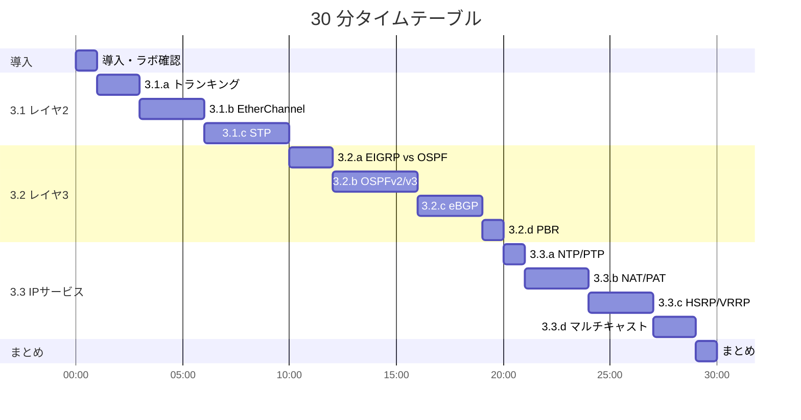

# CCNP ENCOR ハンズオン (30分)

**試験範囲: 350-401 ENCOR / 3.0 インフラストラクチャ**
(レイヤ 2・レイヤ 3・IP サービス)

このコースは、ENCOR の「インフラストラクチャ」ドメインの主要トピックを、
**1 つの共通ラボ**で 30 分間に駆け抜けるためのハンズオンです。

!!! warning "30 分で終えるための前提"
    30 分で 13 トピックを扱うため、**初期コンフィグの事前投入**と**コピー&ペースト中心の進行**が前提です。
    解説は最小限にし、各トピックで「設定 → 確認コマンド → 壊して直す」を 1 サイクル回します。
    詳細な理論は、各ページの表と試験ポイントで補ってください。

## 対象トピック

| 項番 | トピック | 形式 | 時間 |
|------|----------|------|------|
| — | 導入・ラボ確認 | 説明 | 1 分 |
| [3.1.a](31-layer2.md#31a-8021q) | 802.1Q 静的/動的トランキングのトラブルシュート | ハンズオン | 2 分 |
| [3.1.b](31-layer2.md#31b-etherchannel) | 静的/動的 EtherChannel のトラブルシュート | ハンズオン | 3 分 |
| [3.1.c](31-layer2.md#31c-stp-rstp-mst) | RSTP / MST とスパニングツリー拡張機能 | ハンズオン | 4 分 |
| [3.2.a](32-layer3.md#32a-eigrp-ospf) | EIGRP と OSPF の比較 | 解説 | 2 分 |
| [3.2.b](32-layer3.md#32b-ospfv2v3) | OSPFv2/v3 (複数エリア、要約、フィルタ、ネットワークタイプ、パッシブ) | ハンズオン | 4 分 |
| [3.2.c](32-layer3.md#32c-ebgp) | eBGP の設定と確認 (ベストパス選択、ネイバー) | ハンズオン | 3 分 |
| [3.2.d](32-layer3.md#32d-pbr) | ポリシーベースルーティング (PBR) | 解説 + 設定例 | 1 分 |
| [3.3.a](33-ip-services.md#33a-ntp-ptp) | NTP / PTP | ハンズオン + 解説 | 1 分 |
| [3.3.b](33-ip-services.md#33b-natpat) | NAT / PAT | ハンズオン | 3 分 |
| [3.3.c](33-ip-services.md#33c-hsrp-vrrp) | HSRP / VRRP | ハンズオン | 3 分 |
| [3.3.d](33-ip-services.md#33d) | マルチキャスト (RPF、PIM-SM、IGMP、SSM、bidir、MSDP) | 解説 | 2 分 |
| — | まとめ・NTP 同期確認 | 確認 | 1 分 |
| | **合計** | | **30 分** |

## タイムテーブル



## 進め方

1. [0. ラボ準備](00-lab-setup.md) のトポロジーと初期コンフィグを**開始前に**投入します。
2. 各ページの **「ハンズオン」** のコードブロックを該当デバイスに貼り付けます。
3. **「確認」** のコマンドで期待どおりの状態かを確認します。
4. **「壊して直す」** で典型的な障害を再現し、原因の切り分け手順を体験します。
5. 最後に [まとめ・確認問題](99-summary.md) で理解度を確認します。

## 前提知識・必要環境

- CCNA レベルの知識 (VLAN、IP アドレッシング、基本的なルーティング)
- Cisco CML / EVE-NG / GNS3 のいずれか、または実機
    - ルーター 4 台 (IOSv / CSR1000v / Cat8000v など)
    - L2 スイッチ 3 台 (IOSvL2 / Cat9000v など) と PC 1 台 (ルーターで代用可)
- 動作確認バージョンの目安: IOS-XE 17.x (IOSv では一部コマンドが異なる場合があります)

## このドキュメントのローカル表示方法

```bash
python3 -m venv venv
venv/bin/pip install -r requirements.txt
venv/bin/mkdocs serve      # http://127.0.0.1:8000
venv/bin/mkdocs build      # site/ に静的 HTML を生成
```
